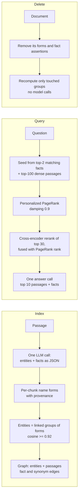

# Lightfoot

GraphRAG with exact, model-free document deletion.

Lightfoot builds a knowledge graph from documents with one language-model call per passage, retrieves with no model calls, and deletes documents as a database operation with no model calls. After a deletion, the graph is identical to a fresh index of the remaining documents, verified on the full 11,402-passage MuSiQue corpus.

This repository holds the reference implementation, the benchmark harness used for the paper, per-question results for every run, and the paper source.

Paper: [paper/main.pdf](paper/main.pdf)

## Results

Recall@5 is the share of gold evidence passages in the top 5 retrieved. EM is exact-match answer accuracy. Index cost is normalised to list prices.

| System | MuSiQue R@5 | 2Wiki R@5 | HotpotQA R@5 | HotpotQA EM | MuSiQue index cost | Delete 10% of docs |
|---|---|---|---|---|---|---|
| **Lightfoot** | **0.646** | 0.884 | **0.943** | **0.630** | **$1.64** | 0 model calls, exact |
| HippoRAG 2 | 0.616 | **0.905** | 0.930 | 0.553 | $2.23 | 0 model calls |
| LightRAG | 0.480 | 0.722 | 0.902 | 0.543 | ≈$9.5 | 2,187 model calls, 3.7 h |
| fast-graphrag | 0.412 | 0.838 | 0.732 | 0.517 | $4.89 | not supported |

Against HippoRAG 2, Lightfoot is significantly better on 5 of 15 paired comparisons, significantly worse on 2 (both on 2WikiMultiHopQA), and tied on 8. Full tables, intervals and caveats are in the paper and in [docs/design/05-results-all.md](docs/design/05-results-all.md).

## How it works



Every stored record is a function of the live per-chunk forms only, never of insertion order, batching or history. That is what makes deletion exact. The design and how it changed during benchmarking are in [docs/design/01-architecture.md](docs/design/01-architecture.md), section 11.

## Repository layout

| Path | Contents |
|---|---|
| `lightfoot/` | The Lightfoot package: extraction, resolution, provenance ledger, graph, retrieval, answering, stores (SQLite, PostgreSQL), optional Elasticsearch channel |
| `harness/` | Benchmark harness: dataset builders, metrics, cost ledger, runner, answer-only rerun, LiteLLM proxy config, adapters and subprocess workers for each baseline |
| `tests/` | 82 tests, including the exact-erasure tests |
| `runs/` | One YAML per benchmark run |
| `data/` | The question and passage subsets used in the paper (parquet), built from the public datasets |
| `results/` | Per-question predictions, scores, cost ledgers and summaries for every reported run (index stores are not included) |
| `scripts/` | Diagnostics and validation scripts, plus dataset download |
| `docs/design/` | Architecture, evaluation plan, results write-ups, paper draft notes |
| `docs/frameworks/` | Source-code reviews of 17 open-source GraphRAG frameworks |
| `paper/` | LaTeX source and PDF |

## Setup

Tested on macOS 14 (Apple M3 Pro, 18 GB) with Python 3.14 for Lightfoot and 3.12 for two baselines.

```bash
python3 -m venv .venv
.venv/bin/pip install -r requirements.txt
cp .env.example .env    # then put your OpenRouter key in .env
```

Lightfoot's tests need no API key:

```bash
.venv/bin/python -m pytest -q tests
```

### Datasets

The `data/` folder already holds the exact subsets used in the paper. To rebuild them, or build other sizes, download the raw datasets into a sibling `datasets/` folder:

```bash
./scripts/download_datasets.sh
.venv/bin/python -m harness.datasets build musique 1000
```

### Baselines

Each baseline runs in its own virtual environment under `envs/`, driven by a worker process:

```bash
./envs/setup_baselines.sh
```

This installs LightRAG (lightrag-hku 1.5.7), HippoRAG 2 (2.0.0a5) and fast-graphrag (0.0.5, commit 23b3a1b). LightRAG runs on PostgreSQL with pgvector; see the script for the database setup.

## Running the benchmark

Lightfoot alone (calls OpenRouter directly):

```bash
./lf_v2.sh lightfoot_v5a_musique_1000
```

Baselines (start a local LiteLLM proxy and embedding server, then run each system):

```bash
DATASETS="musique_1000" ./run_all.sh lightrag hipporag2 fastgraphrag
```

Summary tables from saved results:

```bash
.venv/bin/python -m harness.report musique_1000
```

Models used in the paper, set in `.env` and `harness/proxy.yaml`:

| Role | Model |
|---|---|
| Graph building (extraction) | meta-llama/llama-3.3-70b-instruct |
| Answers | openai/gpt-5.6-luna, reasoning off |
| Embeddings (local) | BAAI/bge-base-en-v1.5 |
| Reranker (local) | BAAI/bge-reranker-base |

The MuSiQue benchmark for all four systems cost about $35 at list prices on OpenRouter. Expect actual bills to run about 1.45 times list price, depending on provider routing.

## Citation

```bibtex
@article{allu2026lightfoot,
  title  = {Lightfoot: Graph Retrieval-Augmented Generation with Exact, Model-Free Document Deletion},
  author = {Allu, Uday},
  year   = {2026},
  note   = {arXiv preprint}
}
```

## License

MIT for the code in this repository. The datasets keep their original licenses (MuSiQue CC BY 4.0, HotpotQA CC BY-SA 4.0, 2WikiMultiHopQA Apache 2.0, MultiHop-RAG ODC-BY); see [docs/datasets.md](docs/datasets.md). The baseline frameworks are installed from their own repositories under their own licenses.
